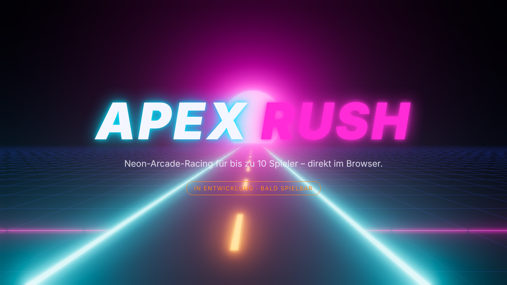
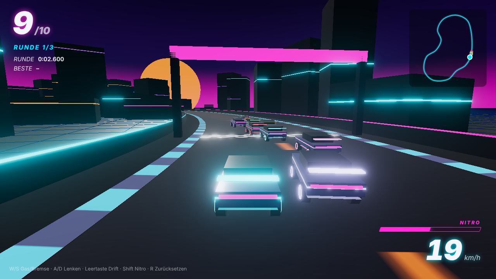
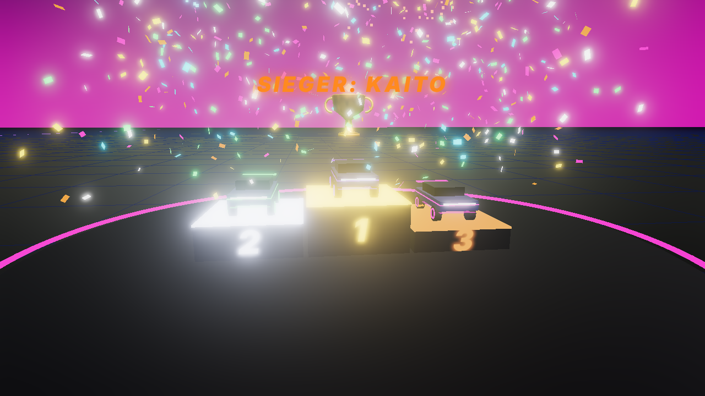
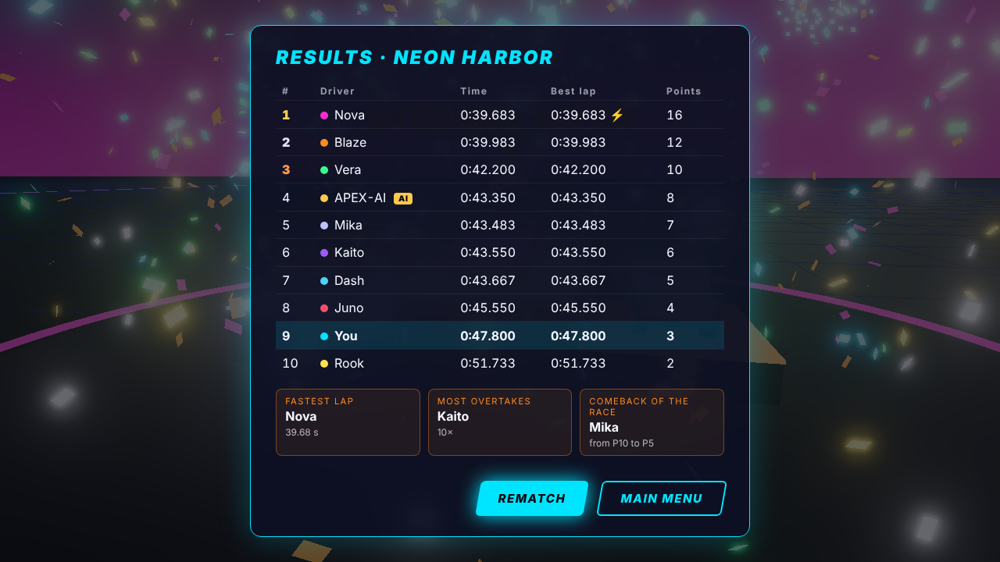
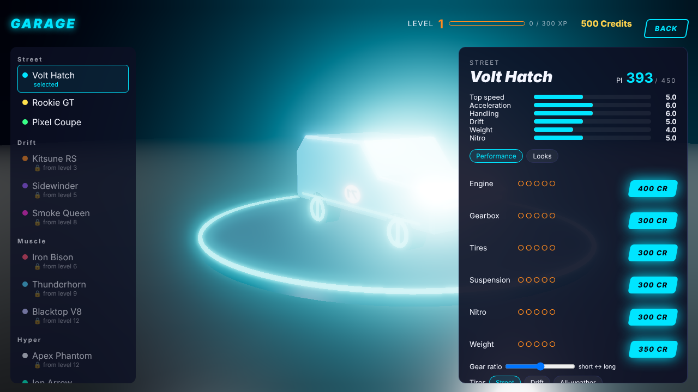

<div align="center">

# APEX RUSH

**Neon arcade racing for up to 10 players – right in your browser.**

[▶ Play now](https://johendel.github.io/Race/) · [Progress](PROGRESS.md) · [Changelog](CHANGELOG.md) · [AI driver](docs/ai-driver.md)



</div>

> 🚧 **Work in progress.** Playable today: online races with up to 10 players, Grand Prix and single races against bots, a garage with 12 cars, and a test ground. Every commit on `main` is deployed automatically.

| Racing against the field | Podium ceremony |
| --- | --- |
|  |  |
| **Results & Grand Prix standings** | **Garage & tuning** |
|  |  |

## Features

- **Up to 10 players online** via room code or link – no account, no server (peer-to-peer WebRTC)
- **APEX-AI:** a machine-learning driver in every race, developed along CRISP-DM ([documentation](docs/ai-driver.md)) – *in development*
- **Multiple laps, Grand Prix scoring and podium** with confetti, trophy and awards (fastest lap, drift king, most overtakes, comeback)
- **12 cars in 4 classes** to unlock, with performance and visual tuning and a performance index per class
- **Drift boost in three stages, nitro, jumps**
- Rule-based bots fill empty grid slots

## Play online

1. **Online spielen → Raum erstellen** (Play online → create room)
2. Send the room code or link to your friends (up to 10 players)
3. Everyone presses **Bereit** (ready), then the host starts the race. Free slots are filled with bots.

The connection runs directly between browsers (WebRTC). The free public PeerJS server is only used to set up the connection. Very strict corporate or campus networks may block direct connections.

## Controls

| Action | Keyboard | Gamepad |
| --- | --- | --- |
| Throttle / brake | W / S or ↑ / ↓ | RT / LT |
| Steer | A / D or ← / → | Left stick |
| Drift | Space | A |
| Nitro | Shift | X |
| Reset car | R | Y |

## Run locally

```bash
corepack enable
pnpm install
pnpm dev
```

Tests: `pnpm test` (unit tests), `pnpm test:e2e` (browser tests, including a full race and a two-window online race).

## Architecture (modular)

```
packages/
  client/   game in the browser: rendering, UI, input, garage
  net/      peer-to-peer networking: lobby protocol, snapshots, interpolation
  shared/   game data and rules: cars, tuning, tracks, scoring, progression
  sim/      physics and race logic without graphics, used by AI training (planned)
  ai/       APEX-AI: data, model, training, evaluation (planned)
```

TypeScript · Vite · Three.js · Rapier physics · PeerJS/WebRTC · Vitest · Playwright · GitHub Actions + Pages

## AI driver (CRISP-DM)

APEX-AI is trained on telemetry from a headless simulation that uses the same physics as the game. Stage 1 imitates the rule-based bots (behavior cloning). Stage 2 fine-tunes the model with an evolution strategy or reinforcement learning. The development is documented phase by phase in **[docs/ai-driver.md](docs/ai-driver.md)**, including all data analysis parameters: dataset size, feature statistics, data quality, train/validation/test split, metrics and learning curves.

## License

Code: [MIT](LICENSE). Assets: see [assets/CREDITS.md](assets/CREDITS.md) – CC0 or similarly free licenses only.
