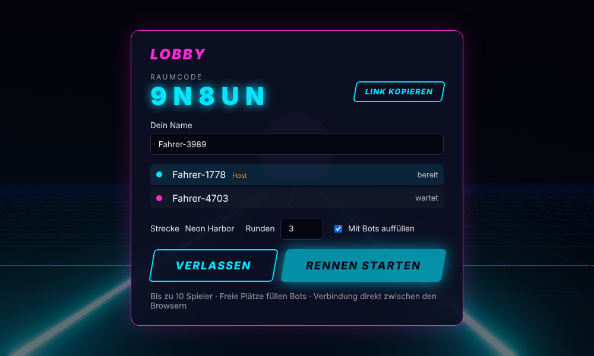

<div align="center">

# APEX RUSH

**Neon-Arcade-Racing für bis zu 10 Spieler – direkt im Browser.**

[▶ Jetzt spielen](https://johendel.github.io/Race/) · [Fortschritt](PROGRESS.md) · [Changelog](CHANGELOG.md)


| Rennen gegen 9 Bots | Siegertreppe |
| --- | --- |
|  |  |
| **Ergebnis & Grand-Prix-Wertung** | **Online-Lobby** |
|  |  |


</div>

> 🚧 **In Entwicklung.** Spielbar: Online-Rennen mit bis zu 10 Spielern, Grand Prix und Einzelrennen gegen Bots, Testgelände. Das Spiel wird Meilenstein für Meilenstein gebaut. Jeder Stand auf `main` ist automatisch unter dem Link oben spielbar.

## Features (geplant)

- **Bis zu 10 Spieler online** per Link oder Raumcode – ohne Konto, ohne Server (Peer-to-Peer)
- **8 Strecken in 2 Cups** mit Abkürzungen, Sprüngen und Ereignissen wie Zugbrücken und Lavaströmen
- **Mehrere Runden, Grand-Prix-Wertung und Siegertreppe** mit Konfetti, Pokal und Ergebnistabelle
- **12 Fahrzeuge in 4 Klassen** zum Freischalten, mit Leistungs- und Optik-Tuning
- **Drift-Boost, Windschatten, Nitro, Air-Tricks**
- Chaos-Modus mit Power-ups, Wetter, Nacht, Ghosts, Replays, Fotomodus, Bots

## Online spielen

1. **Online spielen → Raum erstellen**
2. Raumcode oder Link an Freunde schicken (bis zu 10 Spieler)
3. Alle drücken **Bereit**, der Host startet. Freie Plätze füllen Bots.

Die Verbindung läuft direkt zwischen den Browsern (WebRTC). Für den Verbindungsaufbau wird der kostenlose öffentliche PeerJS-Server genutzt. In sehr strengen Firmen- oder Uni-Netzen kann der direkte Aufbau scheitern.

## Steuerung

| Aktion | Tastatur | Gamepad |
| --- | --- | --- |
| Gas / Bremse | W / S oder ↑ / ↓ | RT / LT |
| Lenken | A / D oder ← / → | Linker Stick |
| Drift | Leertaste | A |
| Nitro | Shift | X |
| Zurücksetzen | R | Y |

## Lokal starten

```bash
corepack enable
pnpm install
pnpm dev
```

## Technik

TypeScript · Vite · Three.js · Rapier-Physik · PeerJS/WebRTC · Vitest · Playwright · GitHub Actions + Pages

```
packages/
  client/   Spiel im Browser (Rendering, UI, Eingabe)
  net/      Peer-to-Peer-Netzwerk (Host im Browser)
  shared/   Spielwerte, Strecken, Farben, Wertung
```

## Lizenz

Code: [MIT](LICENSE). Assets: siehe [assets/CREDITS.md](assets/CREDITS.md) – ausschließlich CC0 oder vergleichbar freie Lizenzen.
