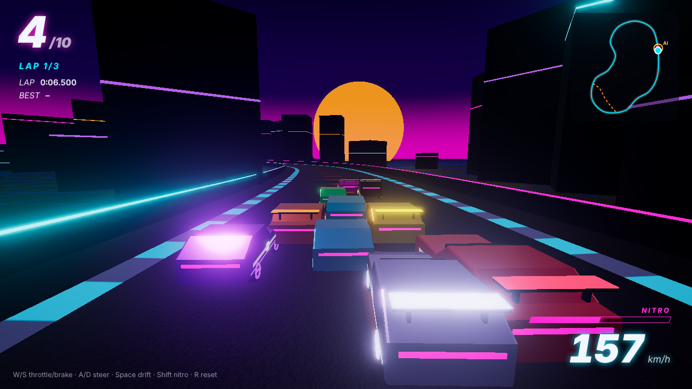
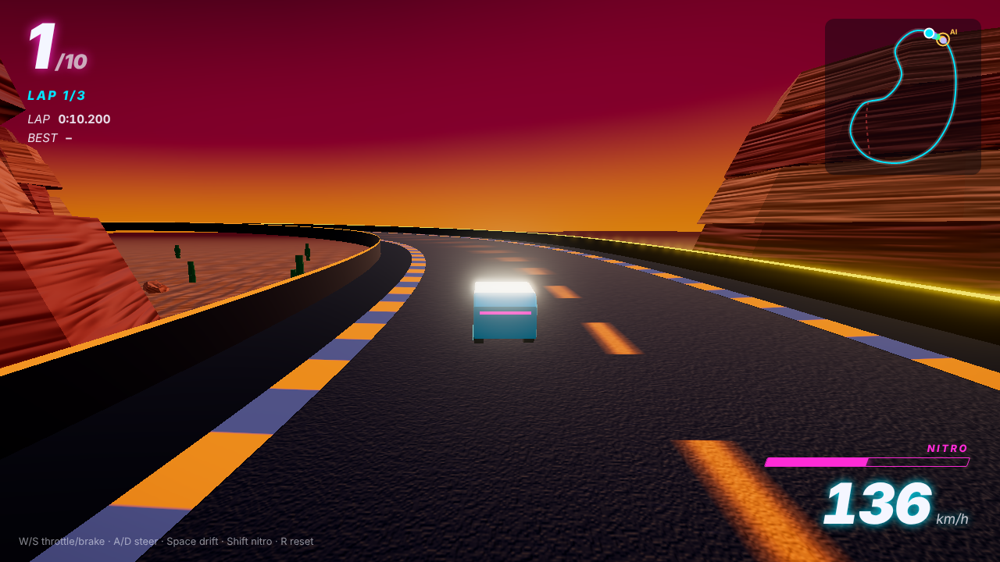
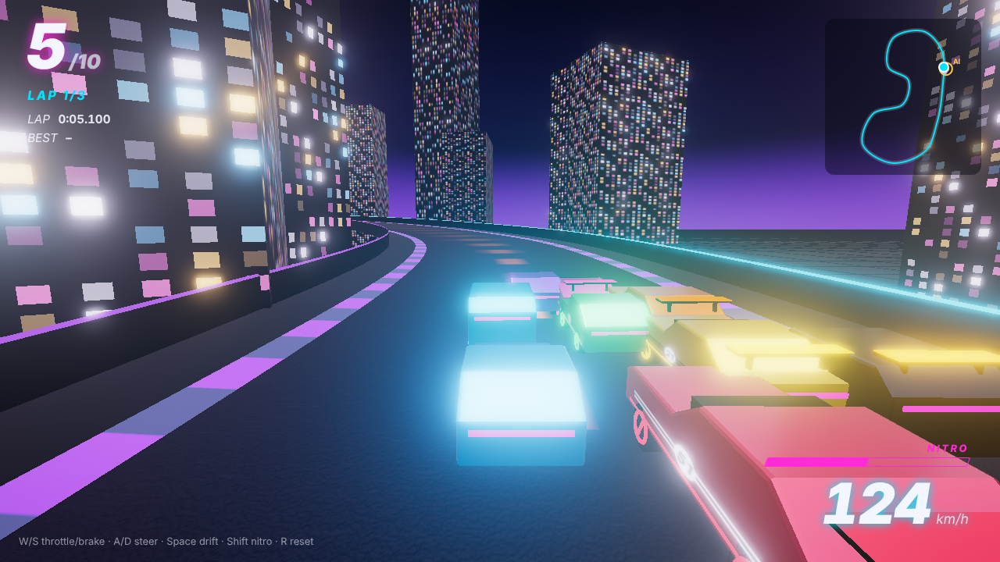
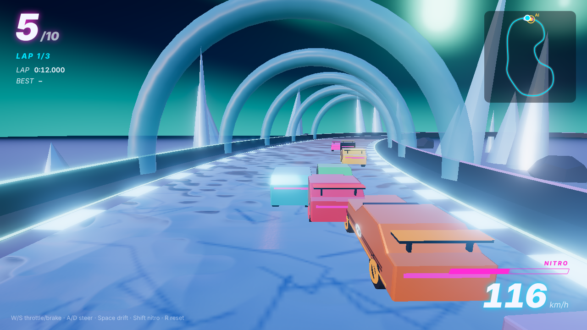
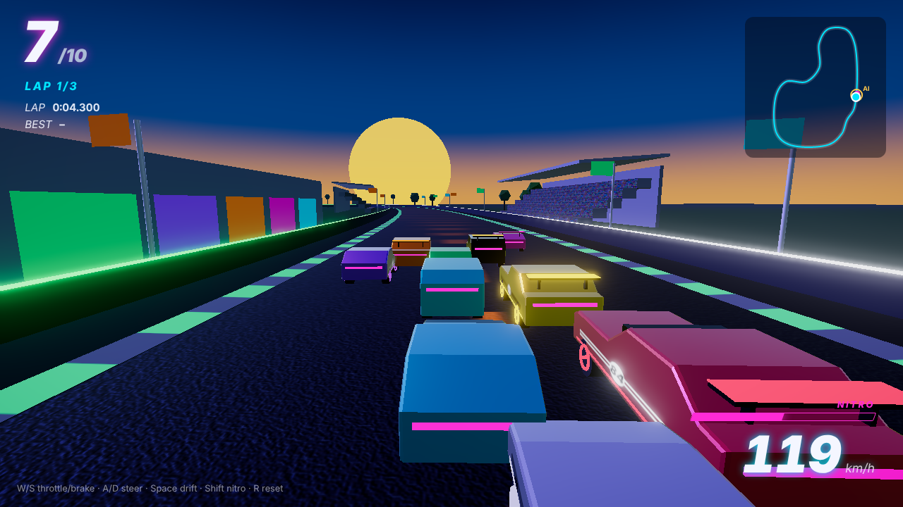
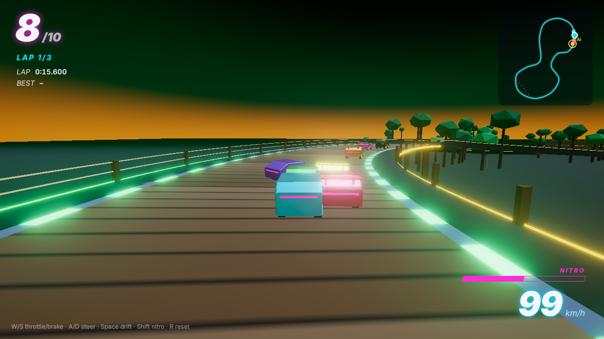
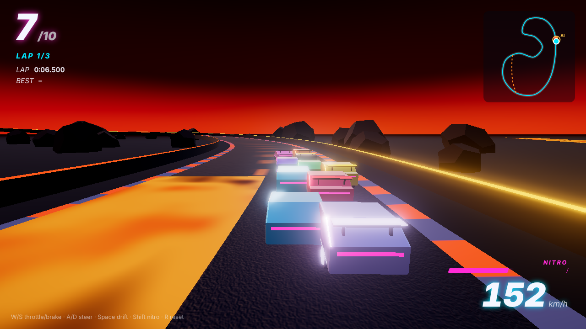
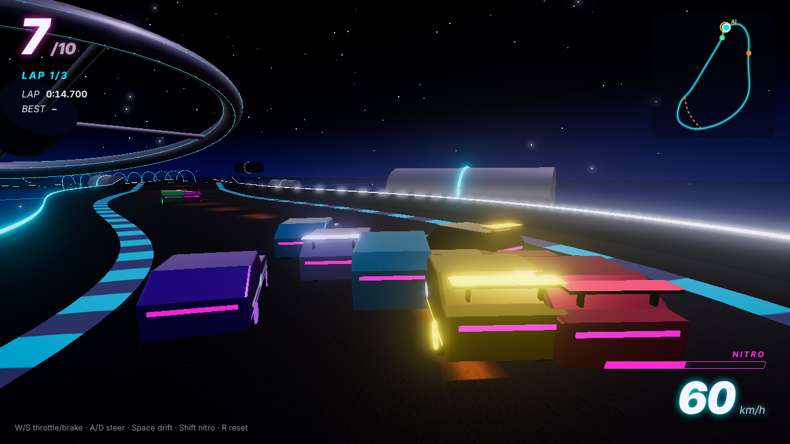
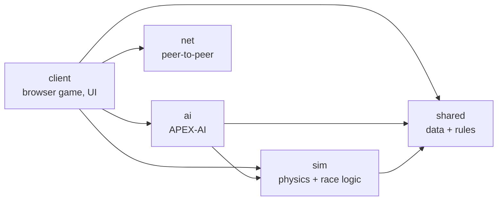

<div align="center">

# APEX RUSH

**Neon arcade racing for up to 10 players – right in your browser.**

[▶ Play now](https://johendel.github.io/Race/) · [AI driver (CRISP-DM)](docs/ai-driver.md) · [Architecture](docs/architecture.md) · [Changelog](CHANGELOG.md)


</div>

> 🚧 **Work in progress.** Playable today: 8 tracks in 2 cups, online races with up to 10 players, Grand Prix and single races against bots and the APEX-AI driver, a garage with 12 cars, and a test ground. Every commit on `main` is deployed automatically.

| Racing against the field | Podium ceremony |
| --- | --- |
|  |  |
| **Results & Grand Prix standings** | **Garage & tuning** |
|  |  |

## Tracks

| Neon Cup | | | |
| --- | --- | --- | --- |
|  |  |  |  |
| **Neon Harbor** – drawbridge from lap 2, warehouse shortcut | **Sunset Canyon** – rockfall opens a canyon shortcut | **Skyline Loop** – neon skyscrapers | **Glacier Rift** – ice patches, ice cave, northern lights |

| Turbo Cup | | | |
| --- | --- | --- | --- |
|  |  |  |  |
| **Grand Circuit** – grandstands and pit lane | **Jungle Ruins** – waterfall, rope bridge, temple shortcut | **Volcano Rush** – lava flows switch sides every lap | **Orbital Station** – low gravity, long jumps |

## Features

- **Up to 10 players online** via room code or link – no account, no server (peer-to-peer WebRTC)
- **APEX-AI:** a machine-learning driver, developed along CRISP-DM ([documentation](docs/ai-driver.md), [data analysis report](docs/ai/report.md)) – races in every race, offline and online, and beats the rule-based bots on an unseen track (94.5 % of their lap time)
- **Multiple laps, Grand Prix scoring and podium** with confetti, trophy and awards (fastest lap, drift king, most overtakes, comeback)
- **12 cars in 4 classes** to unlock, with performance and visual tuning and a performance index per class
- **Drift boost in three stages, nitro, jumps**
- Rule-based bots fill empty grid slots
- **8 tracks in 2 cups** – Neon Cup: Neon Harbor, Sunset Canyon, Skyline Loop, Glacier Rift (slippery ice); Turbo Cup: Grand Circuit, Jungle Ruins (waterfall, rope bridge), Volcano Rush (shifting lava), Orbital Station (low gravity). Pick one on the title screen, in the lobby, or let everyone vote online (with a wheel for ties); the Grand Prix plays the cup of the selected track
- **Shortcuts and live track events:** a warehouse shortcut and a drawbridge that rises from lap 2 on Neon Harbor, a rockfall that opens a canyon shortcut on Sunset Canyon, a collapsing temple on Jungle Ruins
- **Weather & night:** rain with less grip, fog and night races – or random
- **German and English UI** – switch with the button in the top right corner of the title screen

## Play online

1. **Play online → Create room**
2. Send the room code or link to your friends (up to 10 players)
3. Everyone presses **Ready**, then the host starts the race. APEX-AI always races along, and free slots are filled with bots.

The connection runs directly between browsers (WebRTC). The free public PeerJS server is only used to set up the connection. Very strict corporate or campus networks may block direct connections.

## Controls

| Action | Keyboard | Gamepad |
| --- | --- | --- |
| Throttle / brake | W / S or ↑ / ↓ | RT / LT |
| Steer | A / D or ← / → | Left stick |
| Drift | Space | A |
| Nitro | Shift | X |
| Reset car | R | Y |

## Run locally

```bash
corepack enable
pnpm install
pnpm dev
```

Tests: `pnpm test` (unit tests), `pnpm test:e2e` (browser tests, including a full race and a two-window online race).

AI pipeline: `pnpm ai:all` (record → train → evolve → evaluate → report, about 10 minutes, reproducible with a fixed seed).

## Architecture (modular)

Five packages, each with one job and a small public interface. Arrows show which package imports which:



```
packages/
  client/   game in the browser: rendering, UI, input, garage, language toggle
  net/      peer-to-peer networking: lobby protocol, snapshots, interpolation
  shared/   game data and rules: cars, tuning, tracks, scoring, progression, UI texts
  sim/      physics, tracks, bots and races without graphics (game + AI training)
  ai/       APEX-AI: observation, neural network, training, evaluation, report
```

The game and the AI training use the same `sim` package, so APEX-AI learns on exactly the physics the player drives with. More diagrams (online data flow, AI pipeline, CI): **[docs/architecture.md](docs/architecture.md)**.

TypeScript · Vite · Three.js · Rapier physics · PeerJS/WebRTC · Vitest · Playwright · GitHub Actions + Pages

## How the AI was built (CRISP-DM)

In every race exactly one driver is controlled by a neural network: **APEX-AI**. Its development followed the six phases of CRISP-DM. The full documentation with all data analysis parameters is in **[docs/ai-driver.md](docs/ai-driver.md)**; the numbers are generated by `pnpm ai:report` into **[docs/ai/report.md](docs/ai/report.md)**.

| Phase | What was done | Key result |
| --- | --- | --- |
| 1. Business Understanding | Goal: a fast, fair, human-like opponent. Success criteria: lap time ≤ 105 % of the rule-based bot, < 1 wall contact per lap, 100 % finish rate, < 0.2 ms per step | measurable targets |
| 2. Data Understanding | Telemetry of rule-based bots in a headless simulation with the game's physics | 280,754 samples, 24 features, bots never use nitro |
| 3. Data Preparation | Validity checks, normalization to −1…1, mirrored tracks as augmentation, **split by track** (no data leakage) | train 130,598 / validation 68,513 / test 78,547 |
| 4. Modeling | Own MLP 24 → 32 → 32 → 4 in TypeScript; stage 1 behavior cloning with early stopping; stage 2 evolution strategy with a race-based fitness | steering R² 0.80 on the test track |
| 5. Evaluation | Races on the unseen Grand Circuit: v2 vs v1 vs rule-based bot | v2: **94.5 %** of the bot's lap time, mean place 1.2, 100 % finishes |
| 6. Deployment | Weights as versioned JSON, same code for training and browser inference, host simulates APEX-AI online | **0.038 ms** per step in the browser |

In-game APEX-AI is easy to spot: black-and-gold livery, a gold "AI" ring on the minimap and an AI badge in the results. Everything is reproducible with fixed seeds: `pnpm ai:all`.

## License

Code: [MIT](LICENSE). Assets: see [assets/CREDITS.md](assets/CREDITS.md) – CC0 or similarly free licenses only.
