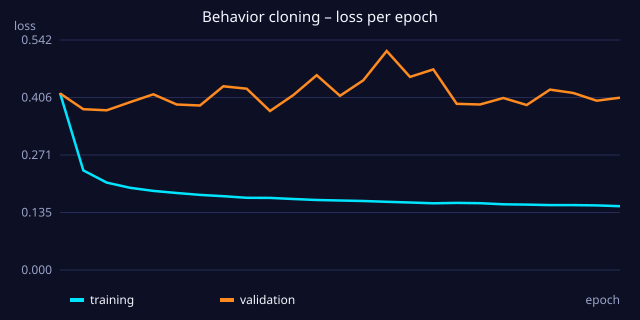
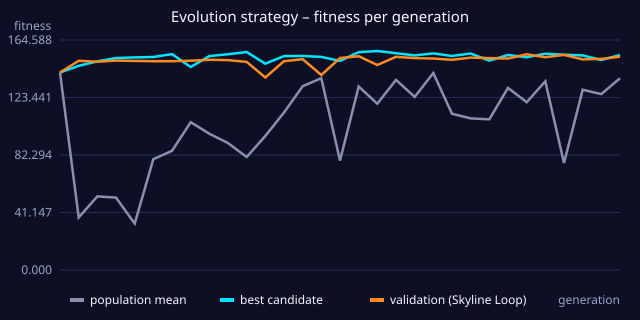

# APEX-AI – How the AI Driver Is Built

APEX-AI is the machine-learning driver of APEX RUSH. A small neural network steers it; no hand-written driving rules do. This document describes its development along the six phases of **CRISP-DM** (Cross-Industry Standard Process for Data Mining).

All numbers below come from the automatically generated **[data analysis report](ai/report.md)** (`pnpm ai:report`, seed 2026). Every step can be reproduced with one command: `pnpm ai:all`.

| Phase | Milestone | Status |
| --- | --- | --- |
| 1. Business Understanding | M6 | ✅ done |
| 2. Data Understanding | M6 | ✅ done |
| 3. Data Preparation | M6 | ✅ done |
| 4. Modeling – stage 1 (behavior cloning) | M6 | ✅ done |
| 4. Modeling – stage 2 (evolution strategy) | M7 | ✅ done |
| 5. Evaluation | M6–M7 | ✅ done |
| 6. Deployment (AI in every race) | M7 | ✅ done |

```
 Business        Data            Data             Modeling          Evaluation        Deployment
Understanding → Understanding → Preparation →   (MLP: cloning → (unseen test   →  (weights as JSON,
 (goal, KPIs)    (telemetry)     (clean, split)   + evolution)      track)            browser inference)
       ↑______________________________________________________________|  iterate
```

---

## 1. Business Understanding

**Goal:** a fast, fair and human-like opponent in every race – whether you play alone or with friends online.

**Why machine learning instead of rules?** The rule-based bots follow the track with fixed formulas. They are predictable and never get better. A learned driver picks up braking points, drift entries and racing lines from data, and it can keep improving with more training (stage 2).

**Success criteria** (measured on a track the model has never seen):

| Criterion | Target | Current result |
| --- | --- | --- |
| Mean best lap compared with the rule-based bot | ≤ 105 % | **94.5 %** ✅ |
| Wall contacts | < 1 per lap | **0.33** ✅ |
| Finish rate | 100 % | **100 %** ✅ |
| Inference time in the browser | < 0.2 ms per step | **0.038 ms** ✅ |

**Constraints:** same cars, physics and information as human players (no view of other players' inputs, no cheating), only free tools, runs fully in the browser.

## 2. Data Understanding

**Data source.** There is no ready-made dataset, so the data is generated: the game's physics and race logic were moved into a separate module (`packages/sim`) that runs **without graphics in Node.js**, faster than real time. Nine rule-based bots drive complete races on several tracks; every 4th physics step (15 times per second and car) the simulation records what each bot *saw* (observation) and what it *did* (action).

| Parameter | Value |
| --- | --- |
| Recorded races | 24 (4 tracks × 2 directions × 3 races, 2 laps each) |
| Simulated driving time | 37.6 min with 9 cars per race |
| Samples recorded | 280,754 |
| Features per sample | 24 |
| Targets per sample | 4 |

**Features (inputs).** Everything is normalized to roughly −1…1 and only uses information a human player can see on screen:

| Group | Features |
| --- | --- |
| Motion | speed, airborne, nitro level, sideways sliding speed, yaw rate |
| Track ahead | angle to the track at 10, 20, 40, 60 and 80 m ahead; curvature near and far |
| Position | signed distance from the centre line |
| Surroundings | 7 distance rays to the walls (−90° … +90°) |
| Opponents | position of the 2 nearest cars relative to the own car |

**Targets (outputs):** steering (−1…1), throttle/brake (−1 full brake … +1 full throttle), drift (on/off), nitro (on/off).

**First findings from the analysis** (details in the [report](ai/report.md)):

- **Steering is predictable from the track ahead:** the angle to the track 40 m ahead correlates with the steering value at r = 0.65; the points at 60 m and 20 m follow closely. This confirms that the chosen features carry the right information.
- **Throttle depends on the curvature ahead** (r = −0.37) and on speed (r = −0.20): bots lift off before corners.
- **Strong class imbalance:** drift is active in only **0.4 %** of samples, braking in 9.6 %.
- **Nitro is missing from the data:** the rule-based bots almost never use nitro (0.001 % of samples). So behavior cloning *cannot* learn nitro. This is an important result of this phase: nitro has to be learned in stage 2, where the AI is rewarded for being fast instead of copying the bots.

## 3. Data Preparation

| Step | What and why |
| --- | --- |
| Cleaning | 3,096 samples (1.1 %) removed: 3,024 from the first second of a race (standing start, no meaningful decision) and 72 from the step in which a car was reset. No missing values occurred (0 % non-finite values in all features). |
| Normalization | Fixed scales per feature (e.g. speed / 60 m/s, ray length / 40 m), stored as part of the observation code, so training and the game use exactly the same inputs. |
| Augmentation | Every track is also driven **mirrored** (left ↔ right). This doubles the data and removes any steering bias towards one side (mean steering after augmentation: −0.002). |
| Split by track | Training: Neon Harbor and Sunset Canyon (+ mirrored), 130,598 samples (47 %). Validation: Skyline Loop (+ mirrored), 68,513 (25 %). Test: Grand Circuit (+ mirrored), 78,547 (28 %). Splitting by track instead of by sample prevents **data leakage**: neighbouring samples of the same corner are almost identical, so a random split would make the results look better than they are. |
| Class weights | Rare positive drift samples are weighted ×10 in the loss so the model does not simply always predict "no drift". |

## 4. Modeling

**Model:** a multilayer perceptron (MLP) written in plain TypeScript without any machine-learning library, so every computation is visible in the code (`packages/ai/src/mlp.ts`).

| Parameter | Value |
| --- | --- |
| Architecture | 24 → 32 → 32 → 4, tanh in the hidden layers |
| Outputs | steering and throttle through tanh (regression), drift and nitro through a sigmoid (classification) |
| Trainable parameters | 1,988 |
| Loss | mean squared error (steering, throttle) + weighted binary cross-entropy (drift, nitro) |
| Optimizer | Adam, learning rate 0.002, batch size 256 |
| Training length | 25 epochs with **early stopping**: the weights of the epoch with the lowest validation loss (epoch 10) are kept |

**Stage 1 – Behavior Cloning (supervised learning).** The network learns to imitate the rule-based bots: input = what the bot saw, target = what the bot did.



The learning curve shows a typical pattern: the training loss keeps falling (0.42 → 0.15), while the validation loss reaches its minimum early and then rises again – the model starts to memorize the training tracks (**overfitting**). The first version kept the weights of the last epoch; with **early stopping** the best epoch is kept instead. This improved the mean lap time on the test track from 104.9 % to 102.8 % of the rule-based bot and the mean finishing place from 5.2 to 4.3.

**Model metrics on the unseen test track (Grand Circuit):**

| Metric | Value |
| --- | --- |
| Steering MAE / R² | 0.060 / 0.80 |
| Throttle MAE / R² | 0.30 / 0.51 |
| Drift accuracy / precision / recall | 99.9 % / 32 % / 73 % |
| Nitro | not learnable from this data (see Data Understanding) |

Steering is predicted well (R² 0.80). Throttle is harder (R² 0.51) because the bots switch between full throttle and lifting off almost like a switch. Drift is detected in 73 % of the real drift moments (recall), but with many false alarms (precision 32 %), which is expected for such a rare class.

**Stage 2 – Fine-tuning with an evolution strategy (reinforcement from race results).** Behavior cloning can at most become as good as its teacher. To beat the teacher, APEX-AI is fine-tuned with an **OpenAI-style evolution strategy** (`packages/ai/src/evolve.ts`):

1. Start from the v1 weights θ.
2. Draw 8 random noise vectors ε and build 16 candidates θ ± σ·ε (*antithetic sampling* halves the noise in the estimate).
3. Every candidate drives one lap against 3 bots in the headless simulation. Its **fitness** is

   `fitness = 100 · progress + (finished ? 90 − lap time : 0) − 3 · wall contacts − 8 · resets − 0.05 · wrong-way steps`

4. The fitness values are replaced by their ranks (*rank shaping*, robust against outliers), and θ moves in the direction of the better candidates (learning rate 0.03).
5. After each generation the new θ drives the **validation track** (Skyline Loop). The weights with the best validation fitness are kept – the same idea as early stopping in stage 1.

| Parameter | Value |
| --- | --- |
| Generations | 30 (training tracks rotate: Neon Harbor, Sunset Canyon and their mirrors) |
| Candidates per generation | 16 (8 antithetic pairs) |
| Noise σ | 0.02 for weights, 0.6 for output biases, 0.15 for the nitro output |
| Compute time | 318 s on one CPU core |
| Validation fitness | 141.3 (v1) → **154.4** (best, generation 25) |
| Validation lap | 44.67 s → **35.64 s** |



The grey line (population mean) jumps strongly because many noisy candidates crash or drive slowly – that is exactly the exploration the method needs. The validation line rises much more steadily.

**Nitro:** behavior cloning saw no nitro at all, so its nitro output was stuck at "off". Before stage 2 this output neuron is reset to zero and explores with a larger σ. The evolution strategy found nitro (up to 12 % of the driving time in some generations) but did not keep it: the final candidates use it in only 0.6 % of the time. A likely reason is that nitro on a one-lap fitness test increases the risk of wall contacts more than it saves time.

**Rejected alternatives:**

| Alternative | Reason |
| --- | --- |
| Random split of samples | Leads to data leakage (see Data Preparation). |
| Large ML library (e.g. TensorFlow.js) | Not needed for a model with 1,988 parameters; a library would hide the steps that are meant to be explained. |
| Pure reinforcement learning from scratch | Needs far more simulation time; behavior cloning gives a good starting point first. |

## 5. Evaluation

All numbers come from `pnpm ai:evaluate` and `docs/ai/report.md` (seed 2026) and are reproducible.

**Setup:** 6 races (3 per direction, 2 laps each) on the **unseen** test track Grand Circuit against 9 rule-based bots. Each of the three drivers starts the same races from the same grid slot: the final model v2, the stage-1 model v1 and a rule-based bot of the highest skill level.

| Metric | APEX-AI v2 (final) | APEX-AI v1 (cloning only) | Rule-based bot |
| --- | --- | --- | --- |
| Finish rate | 100 % | 100 % | 100 % |
| Mean best lap | **40.77 s** | 44.03 s | 43.13 s |
| Lap time vs. bot | **94.5 %** | 102.1 % | 100 % |
| Best single lap | 36.20 s | 43.32 s | 41.12 s |
| Wall contacts per lap | 0.33 | 0.08 | 0.25 |
| Resets per race | 0.33 | 0.67 | 0.67 |
| Mean distance to the centre line | 3.34 m | 2.93 m | 3.24 m |
| Mean finishing place (of 10) | **1.2** | 4.0 | 4.2 |

**Success criteria (from Business Understanding):**

| Criterion | Result | Met |
| --- | --- | --- |
| Lap time ≤ 105 % of the rule-based bot | 94.5 % | ✅ |
| Wall contacts < 1 per lap | 0.33 | ✅ |
| Finish rate 100 % | 100 % | ✅ |

**Interpretation:** stage 1 brought APEX-AI to the level of its teacher; stage 2 made it clearly faster than the teacher (−5.5 % lap time) on a track it never trained on, so the improvement generalizes and is not memorized.

**Typical errors and trade-offs:**

- *More aggressive lines:* v2 brakes later and cuts corners harder. This saves time but raises wall contacts from 0.08 to 0.33 per lap – still well below the limit of 1.
- *Higher variance:* v2's best laps range from 36.2 s to 43.0 s. In crowded starts it sometimes loses time behind slower cars, because the fitness test used only 3 opponents.
- *Nitro is hardly used* (see Modeling). A longer fitness test (2–3 laps) or a reward for overtaking is the next idea.
- *Strength:* with a mean place of 1.2, APEX-AI is hard to beat for beginners. The planned difficulty setting will scale its engine power (not its knowledge), as required by the fairness rules.

## 6. Deployment

| Item | Implementation |
| --- | --- |
| Model files | `packages/ai/models/apex-ai-v1.json` (stage 1) and `apex-ai-v2.json` (stage 2), about 19 KB each, versioned in Git with their training configuration in the JSON |
| Model in the game | `packages/ai/src/currentModel.ts` selects the version (currently **v2**); the client bundles it at build time |
| Inference | `AiDriver` (`packages/ai/src/driver.ts`): observation → MLP forward pass → controls, identical code in training and in the browser |
| Inference time | **0.038 ms per step** measured in headless Chromium (2,000 steps, during a running race) – well below the 0.2 ms budget |
| In every race | offline: APEX-AI takes one grid slot next to the player and the bots; online: the host simulates it and sends it to all clients like any other car |
| Recognizable | own black-chrome and gold livery with a lightning decal, gold "AI" ring on the minimap, "KI"/AI badge in the results table |
| Fairness | same car (Volt Hatch), same physics, only information a player could see (no access to other players' inputs) |

**Retraining from scratch:**

```bash
pnpm ai:record    # record telemetry of the rule-based bots
pnpm ai:train     # stage 1: behavior cloning  → apex-ai-v1.json
pnpm ai:evolve    # stage 2: evolution strategy → apex-ai-v2.json
pnpm ai:evaluate  # race v2 vs v1 vs rule-based bot on the test track
pnpm ai:report    # data analysis parameters and charts → docs/ai/
# or everything at once:
pnpm ai:all
```

All steps use fixed random seeds (2026 for data and training, 7 for the evolution strategy), so the results are reproducible.
