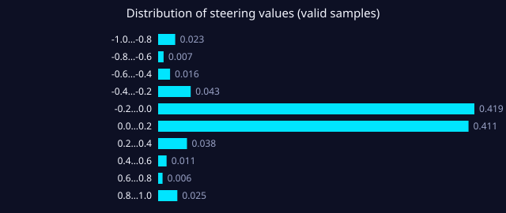
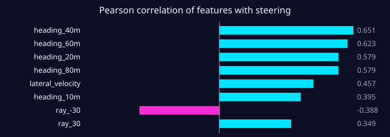
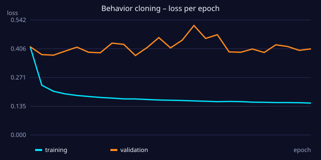
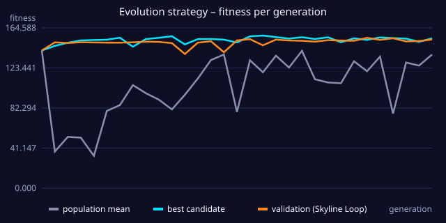

# APEX-AI – Data Analysis Report

> Generated automatically by `pnpm ai:report` (seed 2026). Do not edit by hand.

## 1. Dataset overview

| Parameter | Value |
| --- | --- |
| Recorded races (runs) | 24 |
| Simulated driving time | 37.6 min (9 cars per race) |
| Samples recorded | 280,754 |
| Valid samples | 277,658 (98.9 %) |
| Invalid samples | 3,096 – race start: 3024, car reset: 72 |
| Features (inputs) | 24 |
| Targets (outputs) | 4: steering, throttle/brake, drift, nitro |
| Sampling rate | every 4th physics step = 15 samples per second and car |

**Split by track** (prevents data leakage – validation and test tracks are never seen during training):

| Split | Tracks | Valid samples | Share |
| --- | --- | --- | --- |
| Training | neon-harbor, sunset-canyon, neon-harbor-mirror, sunset-canyon-mirror | 130,598 | 47.0 % |
| Validation | skyline-loop, skyline-loop-mirror | 68,513 | 24.7 % |
| Test | grand-circuit, grand-circuit-mirror | 78,547 | 28.3 % |

## 2. Feature statistics

| Feature | Meaning | Min | Max | Mean | Std. dev. | Invalid |
| --- | --- | --- | --- | --- | --- | --- |
| `speed` | forward speed / 60 m/s | -0.634 | 0.821 | 0.504 | 0.167 | 0.0 % |
| `airborne` | 1 if no wheel touches the ground, else −1 | -1.000 | 1.000 | -0.927 | 0.374 | 0.0 % |
| `nitro_level` | nitro tank fill level | 0.000 | 0.323 | 0.002 | 0.021 | 0.0 % |
| `heading_10m` | angle to the track point 10 m ahead / π (positive = right) | -1.000 | 1.000 | 0.000 | 0.139 | 0.0 % |
| `heading_20m` | angle to the track point 20 m ahead / π | -1.000 | 0.999 | 0.001 | 0.104 | 0.0 % |
| `heading_40m` | angle to the track point 40 m ahead / π | -1.000 | 0.999 | 0.001 | 0.103 | 0.0 % |
| `heading_60m` | angle to the track point 60 m ahead / π | -1.000 | 1.000 | 0.001 | 0.119 | 0.0 % |
| `heading_80m` | angle to the track point 80 m ahead / π | -1.000 | 1.000 | 0.001 | 0.138 | 0.0 % |
| `curvature_near` | direction change of the track over the next 44 m | 0.000 | 0.786 | 0.250 | 0.154 | 0.0 % |
| `curvature_far` | direction change of the track 44–88 m ahead | 0.000 | 0.786 | 0.238 | 0.147 | 0.0 % |
| `lateral_offset` | signed distance from the centre line / wall distance | -0.964 | 1.000 | -0.003 | 0.297 | 0.0 % |
| `ray_-90` | free distance to the wall at −90° (left), up to 40 m | -0.950 | 1.000 | -0.360 | 0.236 | 0.0 % |
| `ray_-60` | free distance at −60° | -0.950 | 1.000 | -0.276 | 0.232 | 0.0 % |
| `ray_-30` | free distance at −30° | -0.950 | 1.000 | 0.263 | 0.330 | 0.0 % |
| `ray_0` | free distance straight ahead | -0.950 | 1.000 | 0.950 | 0.243 | 0.0 % |
| `ray_30` | free distance at +30° | -0.950 | 1.000 | 0.256 | 0.333 | 0.0 % |
| `ray_60` | free distance at +60° | -0.950 | 1.000 | -0.281 | 0.233 | 0.0 % |
| `ray_90` | free distance at +90° (right) | -0.950 | 1.000 | -0.365 | 0.234 | 0.0 % |
| `lateral_velocity` | sideways sliding speed / 15 m/s | -1.000 | 1.000 | 0.002 | 0.096 | 0.0 % |
| `yaw_rate` | rotation speed around the vertical axis / 3 rad/s | -1.000 | 1.000 | -0.000 | 0.123 | 0.0 % |
| `opp1_forward` | nearest opponent: distance ahead / 30 m | -0.999 | 1.000 | 0.231 | 0.495 | 0.0 % |
| `opp1_right` | nearest opponent: distance to the right / 30 m | -0.974 | 0.978 | 0.002 | 0.074 | 0.0 % |
| `opp2_forward` | second nearest opponent: distance ahead / 30 m | -0.999 | 1.000 | 0.421 | 0.576 | 0.0 % |
| `opp2_right` | second nearest opponent: distance to the right / 30 m | -0.962 | 0.999 | -0.001 | 0.087 | 0.0 % |

## 3. Target distribution and class balance

| Target | Statistic |
| --- | --- |
| Steering | mean -0.002, std. dev. 0.266 |
| Throttle/brake | mean 0.482, std. dev. 0.599, braking in 9.6 % of samples |
| Drift | on in 0.4 % of samples (class weight for training: 10.0) |
| Nitro | on in 0.0 % of samples (class weight for training: 10.0) |

## 4. Correlations

Pearson correlation of the strongest features with the targets (valid samples):

| Feature | r (steering) | | Feature | r (throttle) |
| --- | --- | --- | --- | --- |
| `heading_40m` | 0.651 | | `curvature_near` | -0.370 |
| `heading_60m` | 0.623 | | `speed` | -0.201 |
| `heading_20m` | 0.579 | | `ray_0` | -0.108 |
| `heading_80m` | 0.579 | | `opp2_forward` | -0.070 |
| `lateral_velocity` | 0.457 | | `airborne` | -0.056 |
| `heading_10m` | 0.395 | | `ray_-90` | 0.056 |
| `ray_-30` | -0.388 | | `ray_90` | 0.055 |
| `ray_30` | 0.349 | | `opp1_forward` | -0.049 |

## 5. Model and training

| Parameter | Value |
| --- | --- |
| Architecture | MLP 24 → 32 → 32 → 4 (tanh hidden layers) |
| Trainable parameters | 1,988 |
| Loss | MSE (steering, throttle) + weighted binary cross-entropy (drift, nitro) |
| Optimizer | Adam, learning rate 0.002, batch size 256, 25 epochs |
| Early stopping | weights of epoch 10 kept (lowest validation loss 0.3744) |
| Final loss | training 0.1504, validation 0.4058 |

## 6. Model metrics (stage 1, behavior cloning)

These metrics compare the stage-1 network (apex-ai-v1) with the recorded bot actions.

| Metric | Validation (68,513 samples) | Test (78,547 samples) |
| --- | --- | --- |
| Steering MAE | 0.075 | 0.070 |
| Steering R² | 0.848 | 0.803 |
| Throttle MAE | 0.309 | 0.297 |
| Throttle R² | 0.482 | 0.513 |
| Drift accuracy / precision / recall | 96.1 % / 15.5 % / 70.5 % | 99.9 % / 32.1 % / 72.9 % |
| Nitro accuracy / precision / recall | 100.0 % / 0.0 % / 0.0 % | 100.0 % / 0.0 % / 0.0 % |

**Confusion matrix – drift (test):**

| | predicted on | predicted off |
| --- | --- | --- |
| **actual on** | 43 | 16 |
| **actual off** | 91 | 78397 |

**Confusion matrix – nitro (test):**

| | predicted on | predicted off |
| --- | --- | --- |
| **actual on** | 0 | 0 |
| **actual off** | 0 | 78547 |

## 7. Driving evaluation on unseen test tracks

3 races per test track, 2 laps each, against 9 rule-based bots. The comparison driver is a rule-based bot (skill "hard") in the same grid slot.

| Metric | APEX-AI v2 (final) | APEX-AI v1 (cloning only) | Rule-based bot |
| --- | --- | --- | --- |
| Races | 6 | 6 | 6 |
| Finish rate | 100.0 % | 100.0 % | 100.0 % |
| Best lap | 36.20 s | 43.32 s | 41.12 s |
| Mean best lap | 40.77 s | 44.03 s | 43.13 s |
| Lap time vs. bot | 94.5 % | 102.1 % | 100.0 % |
| Wall contacts per lap | 0.33 | 0.08 | 0.25 |
| Resets per race | 0.33 | 0.67 | 0.67 |
| Mean distance to centre line | 3.34 m | 2.93 m | 3.24 m |
| Mean finishing place (of 10) | 1.2 | 4.0 | 4.2 |

## 8. Stage 2 – evolution strategy

| Parameter | Value |
| --- | --- |
| Generations | 30 |
| Start (v1) validation fitness | 141.3 (lap 44.67 s) |
| Best validation fitness | 154.4 |
| Nitro use of the final candidates | 0.6 % of driving time (mean of the last 5 generations) |

## 9. Success criteria

| Criterion | Result | Met |
| --- | --- | --- |
| Lap time ≤ 105 % of the rule-based bot | 94.5 % | ✅ |
| Wall contacts < 1 per lap | 0.33 | ✅ |
| Finish rate 100 % | 100.0 % | ✅ |
