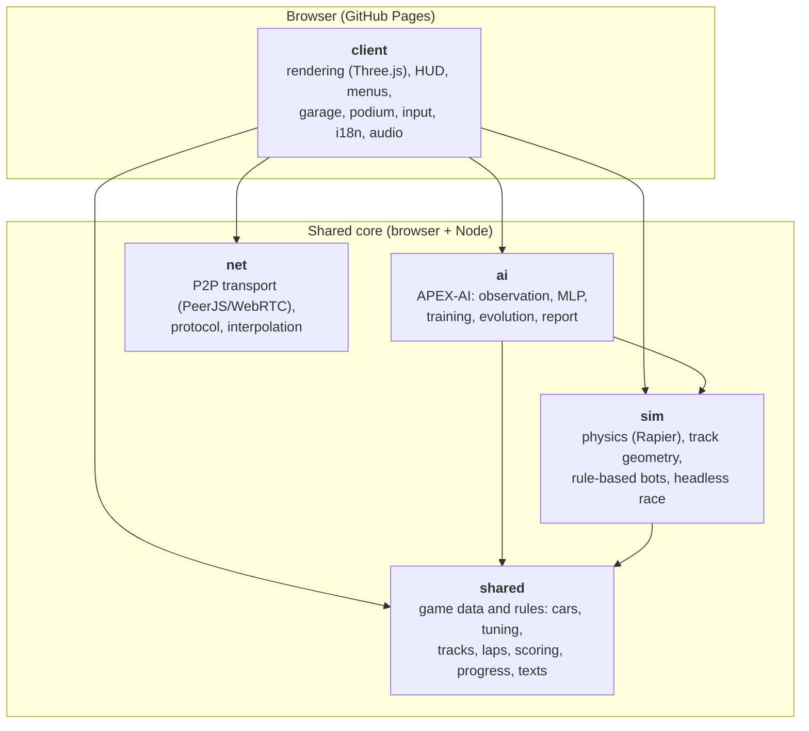
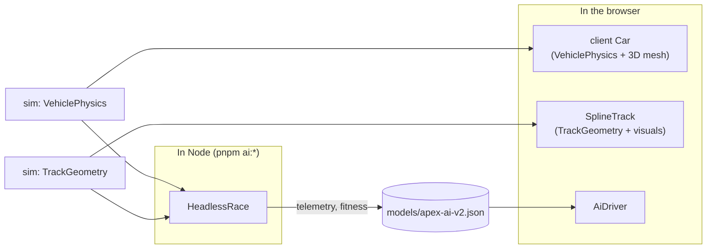
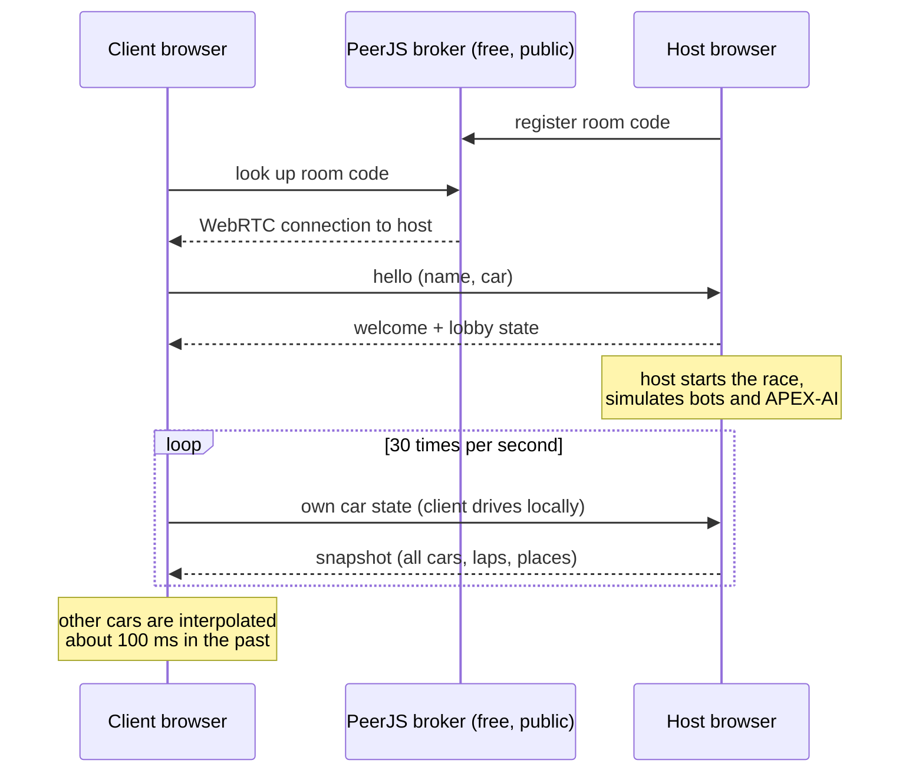
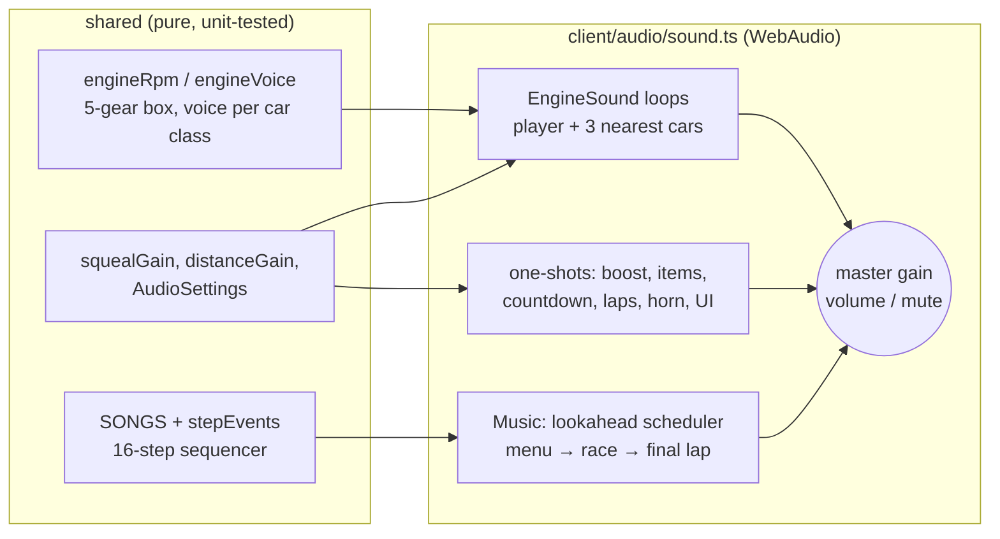
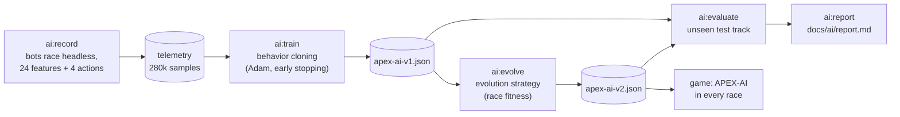

# Architecture

APEX RUSH is a TypeScript monorepo (pnpm workspaces) with five packages. Each package has one job and a small public interface (`src/index.ts`); no package reaches into the internals of another. Everything runs in the browser – there is no game server – and the same simulation code also runs headless in Node for AI training.

## Module overview

Arrows point from a package to the packages it imports. `sim` also offers `@apex/sim/pure` (wheel layout, seeded random) without the physics engine, so menus and the garage do not load Rapier; the race scene and Rapier are a separately loaded chunk (`client/game/engine.ts`). `shared` and `net` depend on no other package, so the dependency graph has no cycles.

| Package | Responsibility | Main public interface | External libraries |
| --- | --- | --- | --- |
| `shared` | Pure game data and rules, no rendering, no physics | `CARS`, `statsFor`, `performanceIndex`, `TRACKS`, `LapTracker`, `rankRacers`, `CupStandings`, `computeAwards`, `SaveGame`, `translate`, ghost/replay encoding, `RivalBook`, audio maths and `SONGS` | – |
| `net` | Peer-to-peer networking and message format | `HostMessage` / `ClientMessage`, `HostTransport` / `ClientTransport`, `SignalingProvider` (`PeerSignaling`, `LocalSignaling`), `SnapshotBuffer` | PeerJS |
| `sim` | Physics and race logic without graphics | `VehiclePhysics`, `TrackGeometry`, `BotDriver`, `HeadlessRace`, `ControlState` | Rapier (WASM), Three.js math |
| `ai` | The machine-learning driver and its pipeline | `observe`, `Mlp`, `AiDriver`, `CURRENT_MODEL`, `trainModel`, `evolve`, `evaluateModel`, `buildReport` | – |
| `client` | The game in the browser | entry point `main.ts` (menu, scenes, online sessions), `audio/sound.ts` (all sound) | Three.js, Rapier, WebAudio |

Game values (car stats, points, lap limits, colors) live as configuration in `shared`, not scattered through the code. Tracks are data as well: a closed spline plus ramps, surface zones (e.g. ice), shortcuts, dynamic events (e.g. a drawbridge that rises from lap 2) and an environment description; `sim` turns them into road, walls, colliders and a `locate()` function that follows cars along the main track or through a shortcut.

## How the game and the AI share one simulation

The client classes `Car` and `SplineTrack` extend the headless classes from `sim` and only add meshes. Because of this the AI is trained on exactly the physics the player drives with.

## Online multiplayer (host-authoritative peer-to-peer)

- The broker is only used to find each other; game data goes directly between the browsers.
- The host decides lap counting, places and the end of the race. Bots and APEX-AI run on the host.
- If a client drops out, a bot drives its car; the player can rejoin within 30 seconds.
- `LocalSignaling` (BroadcastChannel) replaces the broker in the automated tests (`?net=local`).

## Audio (procedural, no sound files)

Every sound is synthesised from oscillators and filtered noise, so there is nothing to download and no licence to check. The audio context starts on the first click or key press (browser autoplay rules). The rules (gearbox, mixing, song patterns) live in `shared` and are unit-tested; the client only turns them into WebAudio nodes.

## AI pipeline

The AI is trained on `forTraining()` variants of the tracks (no shortcuts, no dynamic events), so new track features never change the recorded data – `pnpm ai:evaluate` stays bit-identical.

Details and all numbers: [ai-driver.md](ai-driver.md) (CRISP-DM) and [ai/report.md](ai/report.md).

## Build, tests and deployment

| Step | Tool | Where |
| --- | --- | --- |
| Lint | ESLint (flat config) | every push |
| Type check | TypeScript strict | every push |
| Unit tests | Vitest (rules, physics helpers, networking, AI math, i18n) | every push |
| Build | Vite (static files, base path `/Race/`) | every push |
| End-to-end tests | Playwright: language toggle, sound settings, track/weather choice, test drive, full race with replay and highlights, time trial and drift challenge, host + client online race (horn/emotes), spectator, track vote with chaos mode | every push |
| Deployment | GitHub Actions publishes the build to the `gh-pages` branch | push to `main` |
